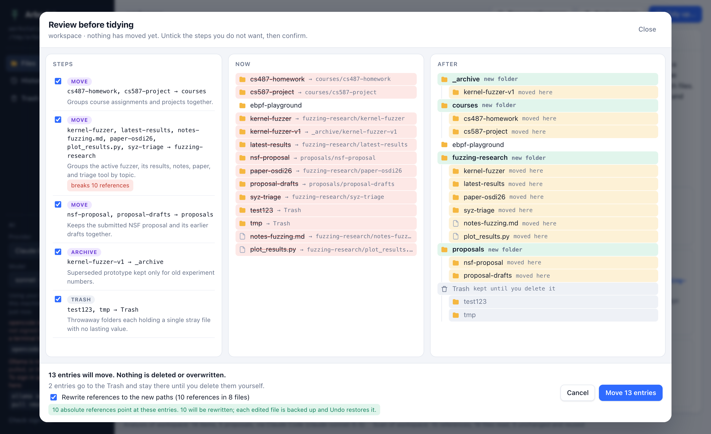
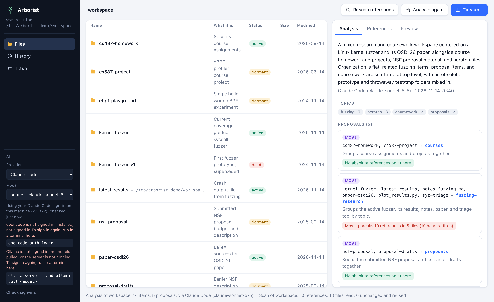

# Arborist

**A file manager that tidies a messy workspace with AI, without breaking what
points into it.**

Workspaces rot: projects drift away from where they started, duplicates pile
up, dead experiments sit next to live ones. An AI model is good at deciding
where things should go. Moving them is the hard part, because scripts,
configs, virtual environments and build files refer to the old paths, and a
plain `mv` breaks them silently.

Arborist looks at a folder, proposes how to reorganize it, shows you the
result next to what you have now, and moves things only after you confirm.
It rewrites the paths that pointed at what moved, and it can undo.



- **Nothing moves until you confirm**, and you can untick any step.
- **Nothing is deleted.** Things to remove go to a trash folder and stay
  there until you delete them yourself.
- **Undo** puts everything back, including the files whose paths were
  rewritten.
- **No API keys.** It uses an AI tool you are already signed in to on the
  machine: Claude Code, Codex, Gemini CLI, opencode or Ollama.

Status: research prototype. Try it on a copy or a small folder first.

## Install

Arborist is one program, `arb`, with nothing else to install. Packages exist
for Linux and macOS, on Intel/AMD (`amd64`) and ARM (`arm64`) processors.

This picks the right package for the machine it runs on:

```bash
os=$(uname -s | tr A-Z a-z); arch=$(uname -m | sed 's/x86_64/amd64/; s/aarch64/arm64/')
curl -fsSL "https://github.com/xjtuwxg/arborist/releases/download/v0.1.0/arborist-0.1.0-$os-$arch.tar.gz" | tar xz
mkdir -p ~/.local/bin && install -m 755 "arborist-0.1.0-$os-$arch/arb" ~/.local/bin/arb
arb version
```

If `arb` is not found afterwards, add `~/.local/bin` to your `PATH`, or
install into another folder that is on it, such as `/usr/local/bin`.

Or download a package by hand from the
[releases page](https://github.com/xjtuwxg/arborist/releases):

| Machine | Package |
|---|---|
| Linux, Intel or AMD | `arborist-0.1.0-linux-amd64.tar.gz` |
| Linux, ARM | `arborist-0.1.0-linux-arm64.tar.gz` |
| Mac with Apple silicon | `arborist-0.1.0-darwin-arm64.tar.gz` |
| Mac with Intel | `arborist-0.1.0-darwin-amd64.tar.gz` |

On a Mac, a package downloaded with a browser is blocked the first time.
Clear that once with `xattr -d com.apple.quarantine ~/.local/bin/arb`.
Packages fetched with `curl`, as above, are not affected.

Windows is not supported.

## Use

Start the web interface on the folder you want to tidy and open the link it
prints:

```bash
arb ui ~/workspace
```

To reach it from another device, for example a server you use over
[Tailscale](https://tailscale.com), start it on the machine's tailnet address:

```bash
arb ui ~/workspace --tailscale
```

Then, in the browser:

1. **Scan references** finds the paths that point into the folder, so
   Arborist knows what a move would break. The first scan of a very large
   folder is slow; later ones reuse it.
2. **Analyze** asks the AI tool to describe each entry and propose moves.
   It sends folder names and the first lines of README files to that tool.
3. **Tidy up…** shows the folder as it is next to how it would look. Untick
   what you do not want, then confirm.



The link carries an access token; anyone with the link can use the
interface, so treat it like a password.

## More

- [Guide](docs/guide.md): every command, how scans, repair, undo and the
  trash work, and what is not handled yet.
- [Research plan](docs/research-plan.md)

The screenshots show a made-up workspace.
